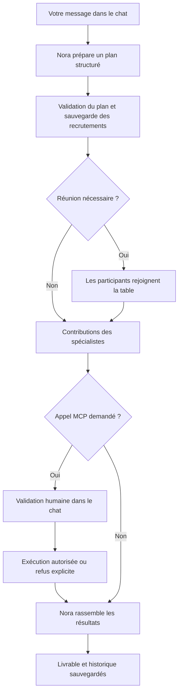

# Atelier — Bureau 3D d’agents IA

Un bureau virtuel pour piloter une équipe d’agents IA depuis une barre de chat. **Nora, l’agent de direction, prépare les missions, recrute les spécialistes nécessaires et rassemble leurs contributions.** L’équipe évolue dans un open space 3D avec postes individuels, table de réunion et salon.

Le moteur IA utilise **le compte Claude connecté à Claude Code**, avec les limites de son abonnement. Aucune clé API Anthropic n’est nécessaire pour ce mode. Le projet est une application locale personnelle, avec des réponses Claude réelles et des animations stylisées.

**Version cloud :** un bureau privé peut maintenant transmettre les missions à une tâche Claude Code cloud et recevoir ses plans, recrutements, contributions et synthèses. Le panneau **Consommation** présente les tokens mesurés et les limites officielles de cinq heures et de la semaine lorsqu’elles sont disponibles. Voir le [guide cloud et suivi d’usage](docs/CLOUD.md).

## Sommaire

- [Fonctionnalités](#fonctionnalités)
- [Fonctionnement des missions](#fonctionnement-des-missions)
- [Prérequis](#prérequis)
- [Installation et configuration](#installation-et-configuration)
- [Lancement et arrêt](#lancement-et-arrêt)
- [Utiliser et gérer l’équipe](#utiliser-et-gérer-léquipe)
- [Gmail, GitHub et MCP](#gmail-github-et-mcp)
- [Sauvegarde et confidentialité](#sauvegarde-et-confidentialité)
- [Fonctionnement permanent et cloud](#fonctionnement-permanent-et-cloud)
- [Architecture](#architecture)
- [Vérifications](#vérifications)
- [Dépannage](#dépannage)
- [Limites actuelles](#limites-actuelles)
- [Licence et références](#licence-et-références)

## Fonctionnalités

| Domaine | Fonctionnement actuel |
| --- | --- |
| Direction | Chat avec Nora, plan structuré, délégation et synthèse finale |
| Recrutement | Création persistante d’agents avec nom, spécialité, couleur et poste |
| Gestion | Retrait et restauration des spécialistes ; historique conservé |
| Bureau 3D | Open space extensible, salon, réunion, éclairage, parquet et plantes |
| Personnages | Marche sur trajets calculés, assise, frappe, respiration et gestes |
| Vie de bureau | Pauses au salon, déplacement vers les réunions et retour au poste |
| Connexions | Détection des MCP de Claude Code et des connecteurs de compte disponibles |
| Outils externes | Activation par service, exclusions par agent et validation de chaque appel |
| Persistance | Équipe, missions, contributions et paramètres enregistrés sur disque |
| Windows | Lanceur par double-clic, ouverture du navigateur et détection d’un serveur existant |

Une nouvelle installation commence avec **Nora** (direction), **Léa** (stratégie et recherche), **Milo** (design et expérience) et **Alex** (développement). Les agents sont des profils orchestrés par le serveur ; ils partagent la même connexion Claude Code.

## Fonctionnement des missions



1. Le serveur place votre demande dans sa file.
2. Nora sélectionne les experts utiles et peut proposer jusqu’à six recrutements.
3. Le serveur valide les noms, références, capacités et consignes avant de modifier l’équipe.
4. Si une réunion est prévue, le navigateur anime le rassemblement et confirme les arrivées. Sans confirmation complète, le serveur poursuit après 60 secondes.
5. Les spécialistes produisent leurs contributions **successivement**. Les appels d’outils externes passent par la validation humaine.
6. Nora rédige une synthèse à partir des contributions réellement obtenues.

Les appels textuels et le planificateur utilisent le programme officiel `claude -p`. Les contributions dotées de MCP utilisent le SDK officiel `@anthropic-ai/claude-agent-sdk`. Les pauses et déplacements visuels ne consomment aucun appel Claude.

## Prérequis

- **Node.js 22 ou supérieur**, avec npm : [téléchargement officiel](https://nodejs.org/).
- **Git** : [installation officielle](https://git-scm.com/downloads).
- **Claude Code officiel**, connecté à un compte disposant d’un accès Claude Code, par exemple Pro ou Max.
- Un navigateur récent avec WebGL ; l’accélération matérielle est recommandée.
- Une connexion Internet pour les appels Claude et les MCP distants.

La version de Claude Code utilisée pendant les vérifications locales est **2.1.311**. Utilisez une version récente : le projet emploie notamment les sorties JSON structurées et le mode `--safe-mode`.

Le studio attend une authentification par abonnement **`claude.ai`**. Une session API Console ou un autre fournisseur n’est pas utilisée comme remplacement automatique. Les règles et quotas du compte s’appliquent ; consultez [l’information officielle sur le SDK avec un abonnement](https://support.claude.com/en/articles/15036540-use-the-claude-agent-sdk-with-your-claude-plan).

## Installation et configuration

### 1. Installer Claude Code et connecter son compte

Suivez le [guide officiel d’installation](https://code.claude.com/docs/en/quickstart). Dans un nouveau terminal, vérifiez les programmes :

```text
node --version
npm --version
git --version
claude --version
```

Lancez ensuite :

```text
claude
```

Utilisez `/login` si nécessaire, choisissez votre compte Claude et terminez la connexion dans le navigateur. Quittez ensuite la session interactive, puis vérifiez :

```text
claude auth status
```

Le compte doit être connecté avec la méthode `claude.ai`. Vous n’avez aucun jeton à copier dans le projet.

### 2. Récupérer le projet et ses dépendances

```text
git clone https://github.com/DRCOMPUTER60290/bureau_3d_agents_ai.git
cd bureau_3d_agents_ai
npm ci
```

### 3. Créer le fichier de configuration

Sous **Windows PowerShell** :

```powershell
Copy-Item .env.example .env
```

Sous **Linux ou macOS** :

```bash
cp .env.example .env
```

Faites cette copie seulement lors de la première installation pour conserver une configuration existante. Ouvrez ensuite `.env` dans votre éditeur :

```dotenv
CLAUDE_MODEL=sonnet
PORT=3001
# CLAUDE_CODE_PATH=C:\Users\votre-nom\.local\bin\claude.exe
# ATELIER_DEMO=1
# ATELIER_DATA_FILE=data/state.json
```

| Variable | Défaut | Utilisation |
| --- | --- | --- |
| `CLAUDE_MODEL` | `sonnet` | Alias ou modèle accessible à votre compte |
| `PORT` | `3001` | Port HTTP du serveur local |
| `CLAUDE_CODE_PATH` | `claude` via le PATH pour le connecteur CLI | Chemin absolu du programme officiel si la commande est introuvable |
| `ATELIER_DEMO` | Désactivé | `1` active une démonstration sans réponse Claude réelle |
| `ATELIER_DATA_FILE` | `data/state.json` | Sauvegarde ; un chemin relatif part du dossier du projet |

Pour trouver l’exécutable sous Windows :

```powershell
(Get-Command claude -ErrorAction Stop).Source
```

Renseignez si nécessaire son chemin absolu dans `.env`, puis redémarrez le serveur. Le SDK recherche également l’installation native dans le répertoire personnel. Les variables déjà définies dans l’environnement du processus restent prioritaires sur `.env`.

### 4. Construire et démarrer

```text
npm run build
npm start
```

Ouvrez **[http://127.0.0.1:3001](http://127.0.0.1:3001)**. Dans les réglages, vérifiez la connexion Claude Code avant votre première mission. Si vous avez modifié `PORT`, adaptez l’adresse.

## Lancement et arrêt

### Lanceur Windows

Après installation des prérequis et dépendances, double-cliquez sur **[Lancer le bureau IA.cmd](Lancer%20le%20bureau%20IA.cmd)** dans le dossier du projet.

Le lanceur vérifie les prérequis et le port, compile le visuel si nécessaire, démarre le serveur et ouvre votre navigateur par défaut dès que le bureau répond. Si le bureau est déjà lancé, il ouvre simplement son adresse. Une erreur reste affichée dans sa fenêtre.

**Gardez la fenêtre qui exécute le serveur ouverte.** `Ctrl+C` ou sa fermeture arrête ce serveur. Fermer seulement le navigateur laisse le serveur traiter la file. Le lanceur ne configure ni le démarrage automatique de Windows ni la désactivation de la veille.

Pour lancer sans ouverture du navigateur :

```text
node scripts/launch.mjs --no-browser
```

### Mode développement

```text
npm run dev
```

Cette commande démarre Node et Vite avec rechargement du client. Ouvrez [http://127.0.0.1:5173](http://127.0.0.1:5173), ou le port annoncé par Vite s’il est occupé. Le proxy `/api` cible **3001** dans `vite.config.js` : si vous modifiez le port du backend pour développer, adaptez aussi ce proxy.

### Mode démonstration

Définissez `ATELIER_DEMO=1` dans `.env`, puis redémarrez. Vous pouvez explorer le bureau sans mission Claude ni recrutement réel. Pour séparer les sauvegardes, choisissez par exemple `ATELIER_DATA_FILE=data/demo-state.json`.

Pour retrouver le fonctionnement réel, retirez `ATELIER_DEMO` ou définissez-le à `0`, puis redémarrez.

## Utiliser et gérer l’équipe

### Exemples de demandes

```text
Nora, prépare un plan de lancement pour une application de prise de rendez-vous.
Fais travailler Léa sur la stratégie, Milo sur l’expérience et Alex sur la technique.
```

```text
Crée une agente spécialisée en marketing nommée Sofia.
```

```text
Organise une réunion avec Léa et Milo pour choisir trois améliorations du produit.
```

Le titre « développement » ne donne pas accès au shell ou à l’écriture de fichiers : par défaut, un agent produit un livrable textuel. Une action externe nécessite un MCP adapté, disponible pour l’agent et autorisé lors de l’appel.

### Bureau et animations

Le plan s’agrandit avec le nombre d’agents : postes, sol, fenêtres, zones communes et cadrage s’adaptent. Les trajets prennent en compte les meubles et les autres personnages. Les agents se lèvent, marchent vers leur destination et s’assoient avant de travailler ou de se reposer.

Les agents inactifs prennent des pauses visuelles au salon. Leur fiche permet de demander une pause, exécutée lorsqu’ils sont disponibles. Le bouton pause des animations fige les mouvements. La préférence système de réduction des mouvements est prise en compte au chargement.

En réunion, Nora et les experts sélectionnés rejoignent la table pendant les contributions et la synthèse. Les échanges restent textuels, sans voix. Les positions visuelles sont recalculées au chargement ; les missions et l’équipe sont persistées.

### Retirer et restaurer

Sélectionnez un spécialiste, cliquez sur **Supprimer cet agent**, puis confirmez. Son bureau disparaît ; son profil est archivé et ses anciens livrables restent dans l’historique.

Dans les réglages, ouvrez **Agents retirés** puis **Restaurer**. Nora et les agents réservés par une mission sont protégés. La restauration respecte les noms uniques et la capacité maximale.

### Capacités

- 24 agents au total, Nora comprise.
- Jusqu’à six créations et six spécialistes affectés par demande.
- Jusqu’à six spécialistes plus Nora dans une réunion.
- Une mission traitée à la fois ; au plus dix missions en cours ou en attente.
- Plusieurs appels Claude par mission : planification, contributions puis synthèse.

## Gmail, GitHub et MCP

**MCP** permet aux agents d’utiliser les outils d’un service externe. Le studio réutilise les configurations de Claude Code et les connecteurs disponibles ; les comptes se connectent par leurs flux officiels.

### Connecter Gmail ou GitHub

1. Ouvrez les [connecteurs de votre compte Claude](https://claude.ai/customize/connectors).
2. Connectez le service avec les autorisations souhaitées. Sa disponibilité dépend du compte et des connecteurs proposés.
3. Revenez aux réglages du bureau, section **Comptes & MCP**.
4. Cliquez sur **Détecter les MCP de Claude Code** et attendez la fin.
5. Vérifiez le statut et les outils détectés, puis cochez **Disponible pour l’équipe, y compris les futurs agents**.
6. Ajustez **Services accessibles** dans la fiche d’un agent pour l’exclure de certains services.

La détection n’active aucun service automatiquement. Ne collez ni mot de passe ni jeton dans le chat.

### Reprendre les MCP existants

Le catalogue combine les définitions utilisateur, les définitions du projet dans `.mcp.json`, les définitions locales liées au dossier et les MCP fournis par les plugins activés. La découverte officielle peut aussi faire apparaître les connecteurs du compte Claude.

Si un serveur demande une authentification, ouvrez `claude` dans le même dossier, utilisez `/mcp`, terminez sa connexion, puis relancez la détection.

Cette détection ouvre les connexions nécessaires pour lister les outils ; elle n’envoie pas de prompt au modèle et n’exécute pas d’outil métier. Le navigateur reçoit seulement les métadonnées du catalogue, sans les en-têtes secrets, variables ou arguments de configuration.

### Ajouter un MCP HTTP

Dans **Comptes & MCP → Ajouter un autre MCP HTTP**, indiquez un nom et l’URL du serveur. Le studio utilise `claude mcp add --scope project --transport http` pour l’enregistrer dans le projet.

Les URL doivent être HTTPS, ou HTTP sur localhost. Les identifiants, paramètres de requête et fragments dans l’URL sont refusés. Pour un serveur stdio, des en-têtes secrets ou une configuration avancée, utilisez Claude Code selon sa [documentation MCP](https://code.claude.com/docs/en/mcp), puis relancez la détection.

### Autoriser une action

Chaque appel MCP affiche une carte dans le chat avec l’agent, le service, l’outil et les paramètres. Les champs sensibles connus sont masqués. Examinez l’action, puis choisissez **Autoriser cet appel** ou **Refuser**.

L’accord vaut seulement pour l’appel affiché. Refus, attente de cinq minutes, abandon ou révocation de l’accès bloquent l’action. Les paramètres trop volumineux ou imbriqués sont également refusés. Les résultats utiles peuvent être intégrés au livrable et donc à la sauvegarde locale.

Les spécialistes chargent uniquement les MCP sélectionnés pour eux. Les outils système intégrés de Claude Code ne sont pas activés par cette intégration. Planification et synthèse restent textuelles. Les politiques gérées de Claude Code continuent de s’appliquer.

## Sauvegarde et confidentialité

L’état est enregistré dans **`data/state.json`**, ou au chemin `ATELIER_DATA_FILE`. Il contient les agents actifs et archivés, les messages, missions, contributions, services activés et événements de validation. Le dossier est créé au démarrage.

Pour sauvegarder ou transférer l’équipe : arrêtez le serveur, copiez ce fichier dans un emplacement privé, restaurez-le sur la machine cible, puis démarrez une seule instance. Configurez séparément la session Claude Code et les connexions MCP sur cette machine.

Au redémarrage, les missions en cours sont remises en file. Le plan et les contributions terminées sont réutilisés. **Un appel interrompu peut être répété**, notamment une action externe dont le résultat n’aurait pas été sauvegardé. Les missions en erreur ne sont pas relancées automatiquement.

Le studio n’extrait ni ne sauvegarde les jetons de session Claude. Les sous-processus excluent les variables de clé API et de routage pour utiliser l’abonnement. Les prompts et résultats nécessaires transitent toutefois vers Claude et les services externes appelés.

Le dépôt exclut `.env`, les sauvegardes, les configurations personnelles Claude/MCP, les dépendances, builds, journaux et captures locales. Les résultats des missions peuvent contenir des données privées : ne les ajoutez pas au dépôt.

## Fonctionnement permanent et cloud

### Sur votre ordinateur

Le serveur continue de traiter la file navigateur fermé. L’ordinateur doit rester allumé, connecté et sans veille, avec le serveur actif et une session Claude valide. Une action attendant un accord humain peut bloquer la progression puis être refusée à l’expiration du délai.

### Sur un serveur

Le backend pourrait tourner sur une machine toujours allumée avec sa propre installation et session Claude Code. **Ce dépôt ne fournit pas de déploiement de production clé en main.** Il écoute actuellement sur `127.0.0.1`, sans authentification applicative.

Un accès public nécessite notamment authentification, HTTPS, gestion des accès aux services, sauvegarde durable et stockage adapté aux accès concurrents. Une seule instance doit utiliser un même fichier de données. Le lanceur Windows ne remplace pas un superviseur de production.

### Claude Code cloud

La version locale continue d’utiliser Claude Code sur votre machine. Une version hébergée séparée utilise maintenant **une tâche Claude Code cloud liée à votre abonnement**, avec un déclencheur officiel et un retour HTTPS authentifié. Les missions cloud continuent sans votre PC et les résultats restent dans le stockage D1 du bureau hébergé.

Cette première intégration cloud produit des livrables textuels ; elle ne transfère pas les MCP locaux ou les autorisations du bureau local. Le jeton de routine est distinct d’une clé API Anthropic. Le serveur ne relance jamais automatiquement un déclenchement dont le résultat est incertain, car l’API officielle ne fournit pas de clé d’idempotence. Voir les [étapes de configuration et limites du cloud](docs/CLOUD.md).

## Architecture

| Élément | Technologie / responsabilité |
| --- | --- |
| Interface | React 19, Vite 6, Lucide |
| Scène 3D | Three.js, React Three Fiber, Drei |
| Serveur | Node.js, Express 5, API HTTP locale |
| Moteur IA | Claude Code CLI et Claude Agent SDK officiels |
| Persistance | JSON local, écritures séquencées et remplacement du fichier |
| Navigation | Calcul du plan, trajets et animation dans le navigateur |

```text
src/
  main.jsx               Chat, état de l’application et panneau de contrôle
  Office.jsx             Scène 3D et mobilier
  SeatedPerson.jsx       Personnages et poses
  IntegrationsPanel.jsx  Connexions, droits, archives et validations
  materials.js           Matériaux et texture procédurale
  style.css              Interface
shared/
  layout.js              Plan du bureau et répartition des postes
  navigation.js          Trajets et obstacles
  office-life.js         Déplacements, pauses et réunions
server/
  index.js               API, persistance et file de missions
  claude-code.js         Connexion, appels CLI et planificateur
  team.js                Agents, validation des plans et exécution
  meetings.js            Coordination des présences en réunion
  agent-lifecycle.js     Retrait et restauration
  mcp-config.js          Lecture et validation des configurations MCP
  integrations.js        Catalogue, découverte et sessions SDK
  approvals.js           Contrôle des accès et validations d’outils
scripts/
  launch.mjs             Lanceur Windows
  smoke-mcp.mjs          Vérification réelle facultative d’un MCP factice
tests/                   Tests automatisés sans appel Claude
.env.example             Configuration type sans secret
Lancer le bureau IA.cmd   Point d’entrée Windows
```

L’API comprend notamment `/api/state`, `/api/tasks`, la gestion de `/api/agents`, `/api/integrations`, `/api/approvals` et les confirmations de présence en réunion. Elle est destinée à l’interface locale ; ce n’est pas une API publique authentifiée.

## Vérifications

```text
npm test
npm run build
```

Les tests couvrent le connecteur sans shell, les variables d’authentification, les plans et recrutements, la reprise des contributions, le retrait et la restauration, les trajets, pauses, réunions, configurations MCP et autorisations. Ils n’envoient pas de demande au modèle.

Vérification réelle facultative :

```text
node scripts/smoke-mcp.mjs
```

Ce script consomme un appel Claude du compte et vérifie une validation pour un outil factice local. Il ne lit pas Gmail et n’exécute pas d’action sur un service métier externe. Les scénarios réels de recrutement et de mission se lancent explicitement depuis le chat.

## Dépannage

| Problème | Solution |
| --- | --- |
| Node/npm introuvable | Installer Node.js puis rouvrir le terminal ou le lanceur |
| Dépendances absentes | Exécuter `npm ci` dans le projet |
| Claude Code introuvable | Vérifier `claude --version`, le PATH ou `CLAUDE_CODE_PATH`, puis redémarrer |
| Compte non connecté | Ouvrir `claude`, utiliser `/login`, vérifier `claude auth status`, puis actualiser dans le studio |
| Limite Claude atteinte | Consulter l’usage du compte ; tous les agents partagent les quotas |
| Page absente après npm start | Exécuter `npm run build`, vérifier le port et l’adresse |
| Vite fonctionne mais pas les missions | Vérifier le backend et le port du proxy dans `vite.config.js` |
| Port occupé | Arrêter le programme concerné ou modifier `PORT` ; adapter aussi le proxy en développement |
| MCP absent ou en échec | Vérifier sa configuration et `/mcp` dans Claude Code, puis relancer la détection |
| Action externe en attente | Examiner la carte de validation du chat ; une approbation expirée n’est plus utilisable |
| Réunion en attente | Garder la scène ouverte avec les animations ; le serveur poursuit après le délai de continuité |
| Équipe différente après transfert | Vérifier `ATELIER_DATA_FILE` et restaurer la sauvegarde, serveur arrêté |
| Rendu lent ou indisponible | Vérifier WebGL, l’accélération matérielle et le pilote graphique ; réduire les animations |
| Lanceur bloqué après un arrêt brutal | Vérifier qu’aucun serveur/lanceur de ce projet ne tourne ; supprimer seulement `data/launcher.json` s’il reste présent, puis relancer |

## Limites actuelles

- Rendu stylisé et animation procédurale ; pas de personnages photoréalistes ni de capture de mouvement.
- Les déplacements et pauses donnent vie à l’équipe ; ils ne constituent pas du travail IA permanent.
- Contributions et missions séquentielles, sans conversation vocale ni processus autonome permanent par agent.
- Pas de planification récurrente de missions depuis le bureau ni de supervision illimitée : les tâches cloud utilisent les quotas de l’abonnement.
- Les missions cloud de cette version sont textuelles ; les MCP du mode local ne sont pas disponibles automatiquement dans le cloud.
- Chaque appel MCP demande une validation humaine : le fonctionnement n’est pas entièrement sans surveillance.
- Stockage JSON prévu pour une instance et un usage personnel local ; pas de gestion multiutilisateur.
- Aucun accès automatique aux outils système de shell ou d’édition de fichiers pour les agents du studio.
- Pas de garantie d’exécution unique d’une action externe lors d’une interruption avant sauvegarde.

## Licence et références

Le code est distribué sous [licence MIT](LICENSE), copyright DRCOMPUTER60290. Les services, modèles et bibliothèques restent soumis à leurs propres conditions. Ce projet est indépendant et n’est pas un produit officiel d’Anthropic.

- [Installer et connecter Claude Code](https://code.claude.com/docs/en/quickstart)
- [Exécuter Claude Code par programme](https://code.claude.com/docs/en/headless)
- [Utiliser le SDK avec un abonnement Claude](https://support.claude.com/en/articles/15036540-use-the-claude-agent-sdk-with-your-claude-plan)
- [Configurer les MCP](https://code.claude.com/docs/en/mcp)
- [Connecteurs du compte Claude](https://claude.ai/customize/connectors)
- [Sessions Claude Code cloud](https://code.claude.com/docs/en/claude-code-on-the-web)
- [Tâches cloud planifiées](https://code.claude.com/docs/en/routines)
